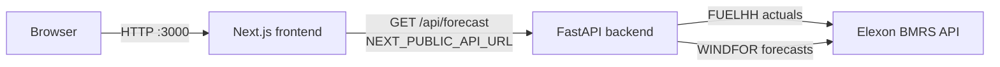

# WindCast Analytics

WindCast Analytics is a small full-stack application for evaluating UK wind generation forecasts against actual generation. It is intended as a starting point for **day-ahead procurement analysis**: understanding how much wind output was forecast, how much was actually produced, and how large and biased the forecast error was over a selected period.

The application fetches data from the public **Elexon BMRS API**, joins actual wind generation with eligible forecast publications, and presents the matched records as a chart, a table, and a set of summary metrics.

> **Status:** This is an MVP / technical assignment implementation. It is not an operational procurement tool. See [Data limitations and assumptions](#data-limitations-and-assumptions) before using any output.

---

## Problem statement

Wind generation is variable and difficult to forecast. For a market participant making day-ahead procurement decisions, the useful question is not only "what was forecast?" but also "how reliable was that forecast, and in which direction did it err?"

This project makes that comparison explicit for UK wind:

- Fetch **actual** wind generation from Elexon `FUELHH`.
- Fetch **forecast** wind generation from Elexon `WINDFOR`.
- Match forecast and actual records for the same delivery time.
- Quantify the error with MAE, RMSE, and bias.
- Show average actual and average forecast generation alongside the time series.

---

## Features

- **Date filtering** for a selected range within January 2026. The start date is inclusive and the end date includes the whole day; the backend uses a UTC half-open interval from `start_dateT00:00:00Z` up to, but not including, midnight after `end_date`.
- **Actual-versus-forecast line chart** over the selected period, rendered in UTC with Recharts.
- **Matched generation records** table showing delivery time, actual MW, forecast MW, signed error, and forecast publication time.
- **MAE, RMSE, and forecast bias** calculated from the matched records (also available from the backend `/api/accuracy` endpoint).
- **Average actual generation** and **average forecast generation** over the matched records.
- **Loading, error, and empty states** in the frontend.
- **Health and accuracy API endpoints** in addition to the forecast endpoint.
- **Docker Compose** setup that runs the frontend and backend together.

---

## Technology stack

Versions below are taken from the existing dependency and configuration files.

### Frontend

| Technology | Version / notes |
| --- | --- |
| Next.js | `16.4.3` (App Router, `src/app`) |
| React / React DOM | `19.3.0` |
| TypeScript | `^5` |
| Tailwind CSS | `^4` via `@tailwindcss/turbopack` |
| Recharts | `^3.10.1` for the chart |
| lucide-react | `^1.62.0` for icons |

### Backend

| Technology | Version / notes |
| --- | --- |
| Python | `3.12` (backend Dockerfile `python:3.12-slim`) |
| FastAPI | `0.162.0` |
| Uvicorn | `0.54.0` |
| Pandas | `3.1.0` |
| NumPy | `2.5.4` |
| HTTPX | `0.28.1` for calls to Elexon |

### Infrastructure

- **Docker Compose** for running both services together.
- Multi-stage Docker build for the frontend (`node:22-alpine`) and a slim Python image for the backend.

---

## Architecture

The browser talks directly to the FastAPI backend. The Next.js server hosts the UI; it does not proxy API requests.



Request flow:

1. The user selects a start and end date in the browser.
2. The frontend calls `GET /api/forecast` on the URL in `NEXT_PUBLIC_API_URL`.
3. The backend fetches WIND actuals from `FUELHH` and forecasts from `WINDFOR`.
4. The backend filters, joins, and returns matched records in UTC.
5. The frontend renders the chart, table, and summary metrics from the returned records.

Because the browser calls the backend directly, the backend's CORS configuration must allow the frontend origin. The current code allows `http://localhost:3000` and `http://127.0.0.1:3000`. Any other deployment origin requires a configuration change outside this README.

---

## Data source and endpoints

All data comes from the public **Elexon BMRS API v1**:

- Base URL: `https://data.elexon.co.uk/bmrs/api/v1`
- Actual wind generation: `https://data.elexon.co.uk/bmrs/api/v1/datasets/FUELHH`
- Wind forecast stream: `https://data.elexon.co.uk/bmrs/api/v1/datasets/WINDFOR/stream`

### `FUELHH` — actual generation

The backend requests WIND records with:

- `settlementDateFrom` — requested start date
- `settlementDateTo` — requested end date (fetched in chunks of up to seven days)
- `fuelType=WIND`

Rows are retained only where `fuelType` is `WIND`, and actual `generation` values are parsed as numbers.

### `WINDFOR` — forecast generation

The backend requests forecast records with:

- `publishDateTimeFrom=2025-12-01T00:00:00Z`
- `publishDateTimeTo=<end_date>T23:59:59Z`

Forecast records are filtered to the requested delivery window, then limited to publications at or before the application's computed decision cutoff. For each delivery interval, the latest eligible publication is kept.

No API key or credentials are configured in this repository. Refer to Elexon for the current API terms, availability, and documentation.

---

## Local development

### Prerequisites

- Python 3.12 (the version used by the backend container; a compatible local interpreter should also work).
- Node.js 22 (the version used by the frontend container) and npm.
- Internet access to the Elexon BMRS API.

The frontend and backend can be run separately for development. Use two terminals.

### Backend

From the project root:

```powershell
cd backend
python -m venv venv
.\venv\Scripts\Activate.ps1
pip install -r requirements.txt
uvicorn app.main:app --reload --host 0.0.0.0 --port 8000
```

On macOS/Linux, activate the virtual environment with:

```bash
source venv/bin/activate
```

The backend is then available at `http://localhost:8000`. FastAPI also exposes interactive API documentation at `http://localhost:8000/docs`.

> The existing `requirements.txt` is encoded as UTF-16LE with a BOM. `pip` detects the BOM when reading it.

### Frontend

From the project root, in a second terminal:

```bash
cd frontend
npm ci
npm run dev
```

The existing `frontend/.env.local` sets:

```env
NEXT_PUBLIC_API_URL=http://localhost:8000
```

If the variable is absent, the frontend falls back to `http://localhost:8000` in `src/app/page.tsx`. The development server runs at `http://localhost:3000`.

Create Next.js build and production start scripts already exist in `package.json`:

```bash
npm run build
npm run start
```

The frontend's `npm run lint` script runs ESLint. The repository does not include an automated test suite.

---

## Docker setup

From the project root:

```bash
docker compose up --build
```

This builds and starts:

| Service | Host URL | Purpose |
| --- | --- | --- |
| `frontend` | `http://localhost:3000` | Next.js UI |
| `backend` | `http://localhost:8000` | FastAPI application |
| `backend` | `http://localhost:8000/api/health` | Health check |
| `backend` | `http://localhost:8000/docs` | FastAPI interactive docs |

The frontend image is built with `NEXT_PUBLIC_API_URL` defaulting to `http://localhost:8000`. This is deliberate: the API call happens in the user's browser, so `localhost:8000` means the host machine, where Compose publishes the backend port. The browser cannot resolve Compose service names such as `backend`.

To stop the services, press `Ctrl+C`, then run:

```bash
docker compose down
```

`docker compose down` removes the containers and network. No persistent volumes are defined, so there is no application data volume to remove.

To build with a different public API URL, set the environment variable before starting Compose. For example, in PowerShell:

```powershell
$env:NEXT_PUBLIC_API_URL = "https://api.example.com"
docker compose up --build
```

The value is a build argument as well as a runtime environment variable in `docker-compose.yml`; because Next.js inlines `NEXT_PUBLIC_*` variables at build time, the frontend must be rebuilt when this value changes.

---

## API endpoints

The backend runs on port `8000`. Date parameters are optional and default to `2026-01-01` and `2026-01-31`. The requests are restricted to January 2026; dates outside that window return HTTP 400. `start_date` must not be later than `end_date`.

### `GET /api/health`

```bash
curl "http://localhost:8000/api/health"
```

Returns:

```json
{ "status": "healthy" }
```

### `GET /api/forecast`

```bash
curl "http://localhost:8000/api/forecast?start_date=2026-01-01&end_date=2026-01-07"
```

Query parameters:

| Parameter | Required | Format | Description |
| --- | --- | --- | --- |
| `start_date` | No | `YYYY-MM-DD` | Inclusive start date (default `2026-01-01`) |
| `end_date` | No | `YYYY-MM-DD` | Inclusive end date, covering the full day (default `2026-01-31`) |

Response fields:

- `data` — matched records, each with `startTime`, `generation_actual`, `generation_forecast`, `error`, and `publishTime`.
- `count` — number of matched records.
- `source` — `"Elexon BMRS"`.
- `period.start` / `period.end` — the requested dates.
- If no data is available, the response contains an empty `data` array and a `message`, with no `count`, `source`, or `period` fields.

Generation values and `error` are in MW. `startTime` and `publishTime` are ISO-8601 UTC timestamps. `error` is **forecast minus actual**.

### `GET /api/accuracy`

```bash
curl "http://localhost:8000/api/accuracy?start_date=2026-01-01&end_date=2026-01-07"
```

This endpoint reuses the same matching logic as `/api/forecast` and returns:

```json
{
  "count": 0,
  "mae": null,
  "rmse": null,
  "bias": null,
  "unit": "MW"
}
```

When matched data exists, `mae`, `rmse`, and `bias` are numeric values rounded to two decimal places, and the `count` is the number of matched records. When no records match, the numeric metrics are `null` and a `message` is included.

The current frontend calls `/api/forecast`; it calculates its displayed metrics and averages from the returned matched records. `/api/accuracy` is available for API-level checks.

---

## Metric definitions

Let, for each matched interval `i`:

```text
error_i = forecast_i - actual_i
```

The backend and frontend use this same convention: **positive error means overforecast, negative error means underforecast**.

| Metric | Definition | Interpretation |
| --- | --- | --- |
| MAE (mean absolute error) | `(1/n) * Σ abs(error_i)` | Average magnitude of error, in MW; lower is better. |
| RMSE (root mean squared error) | `sqrt((1/n) * Σ error_i^2)` | Error magnitude with larger errors weighted more heavily, in MW; lower is better. |
| Bias | `(1/n) * Σ error_i` | Directional error, in MW. Positive = forecast was higher than actual on average (overforecast); negative = underforecast. |

Bias can be zero even when individual errors are large, so it should be read together with MAE and RMSE. All metrics are computed only over **matched** forecast/actual pairs; unmatched intervals are excluded.

---

## Data limitations and assumptions

- **The current matched output is hourly.** Interval alignment between the actual and forecast series is not independently verified in this implementation and must be validated before operational use.
- **The application is limited to January 2026.** The backend rejects dates outside `2026-01-01` to `2026-01-31`, and the frontend date inputs are constrained to the same window.
- **The day-ahead publication cutoff is an implementation assumption, not a verified market rule.** The backend computes a cutoff of `00:00:00Z` on the delivery date and keeps the latest forecast published at or before that time. The exact market decision cutoff, publication convention, and timezone handling require validation against authoritative rules before this output is presented as official procurement analysis.
- **Matching is exact.** Forecast and actual records are joined on identical `startTime` values. There is no resampling, interpolation, or tolerance-based alignment. Records without an exact match are dropped.
- **Forecast selection is simplified.** Only the latest eligible publication per delivery interval is retained. The fixed publication window starts at `2025-12-01T00:00:00Z`, and only publications up to `end_dateT23:59:59Z` are requested.
- **Live external dependency.** Results depend on Elexon BMRS availability and returned data. The backend has a 45-second HTTP timeout and returns HTTP 502 when the upstream request or response processing fails. No caching or persistence layer is included.
- **Metrics reflect matched coverage only.** If large portions of the selected period cannot be matched, MAE, RMSE, and bias describe the matched subset, not necessarily the full period.
- **Units are MW.** No conversion to MWh, settlement-period energy, or market prices is performed.
- **No deployment or production hardening is included.** There is no authentication, rate limiting, database, monitoring, or verified production deployment configuration in the repository.

---

## Configuration and environment variables

### Frontend

| Variable | Where it is set | Default | Purpose |
| --- | --- | --- | --- |
| `NEXT_PUBLIC_API_URL` | `frontend/.env.local` for local development; Compose build arg / environment for Docker | `http://localhost:8000` | Base URL used by the browser to call the FastAPI backend. |

Because the variable starts with `NEXT_PUBLIC_`, its value is embedded in the client bundle at **build time**. Changing it requires a frontend rebuild. Do not put secrets in `NEXT_PUBLIC_*` variables.

### Backend

The current backend does not read any environment variables. Its base URL, dataset URLs, date limits, CORS origins, and cutoff logic are defined in `backend/app/main.py`.

### Local Docker vs production

- **Local Docker (this repository's default):** the browser and Docker host are the same machine. `NEXT_PUBLIC_API_URL=http://localhost:8000` works because Compose publishes backend port `8000` to the host. The backend CORS allow-list matches the local frontend origins.
- **Production:** set `NEXT_PUBLIC_API_URL` to a publicly reachable backend origin (normally HTTPS), rebuild the frontend image, and update the CORS allow-list in `backend/app/main.py` or terminate both services behind a same-origin reverse proxy. None of this is configured or verified in the repository. No production URL or credentials are included.

---

## Future improvements

- Validate the day-ahead publication cutoff, timezone convention, and interval alignment against authoritative Elexon/BSC rules.
- Normalize actual and forecast series to the same settlement period, with explicit handling for missing or duplicated intervals.
- Replace the January 2026 restriction with a configurable date range and appropriate upstream request limits.
- Move metric calculation to a single shared implementation (or have the frontend consume `/api/accuracy` directly) to avoid duplicated logic.
- Add caching or a small database for repeated queries and offline analysis.
- Add retries, backoff, and clearer handling for transient Elexon API failures.
- Add automated backend and frontend tests, plus CI checks for linting and builds.
- Make CORS origins, API URLs, and date limits environment-configurable for deployment.
- Add observability (structured logs, request metrics) and production deployment documentation once a target environment exists.

---

## Project structure

```text
windcast-analytics/
├── backend/
│   ├── app/
│   │   ├── __init__.py
│   │   └── main.py              # FastAPI app, Elexon fetching, matching, metrics
│   ├── Dockerfile               # Python 3.12 + Uvicorn on port 8000
│   └── requirements.txt
├── frontend/
│   ├── public/
│   ├── src/
│   │   └── app/
│   │       ├── globals.css
│   │       ├── layout.tsx
│   │       └── page.tsx         # Dashboard: date filters, chart, table, metrics
│   ├── Dockerfile               # Multi-stage Node 22 build, Next.js on port 3000
│   ├── next.config.ts
│   ├── package.json
│   ├── package-lock.json
│   └── tsconfig.json
├── docker-compose.yml           # Runs frontend + backend together
└── README.md
```

Local-only or generated directories such as `backend/venv`, `frontend/node_modules`, and `frontend/.next` are intentionally omitted from the tree. `frontend/.env.local` provides the local API URL; it is not copied into the frontend image by the Dockerfile, so Docker builds use the Compose build argument instead.

---

## Author

**Abdul Rahman**
Full Stack Developer | AI Engineering Enthusiast

- GitHub: [https://github.com/abdulrahman2202](https://github.com/abdulrahman2202)
- LinkedIn: [https://www.linkedin.com/in/abdul-rahman-001b34279/](https://www.linkedin.com/in/abdul-rahman-001b34279/)

Developed WindCast Analytics as a full-stack technical project using Next.js, FastAPI, Python, and Docker to analyze UK wind generation forecast performance against actual generation.
